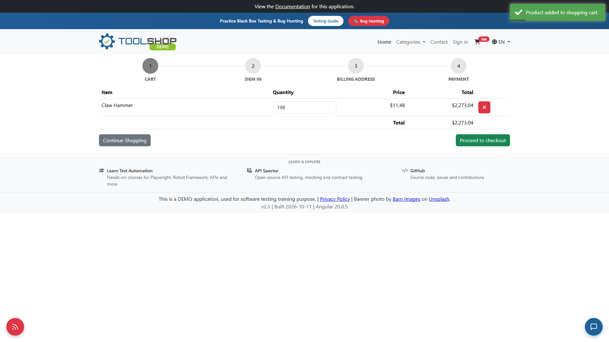
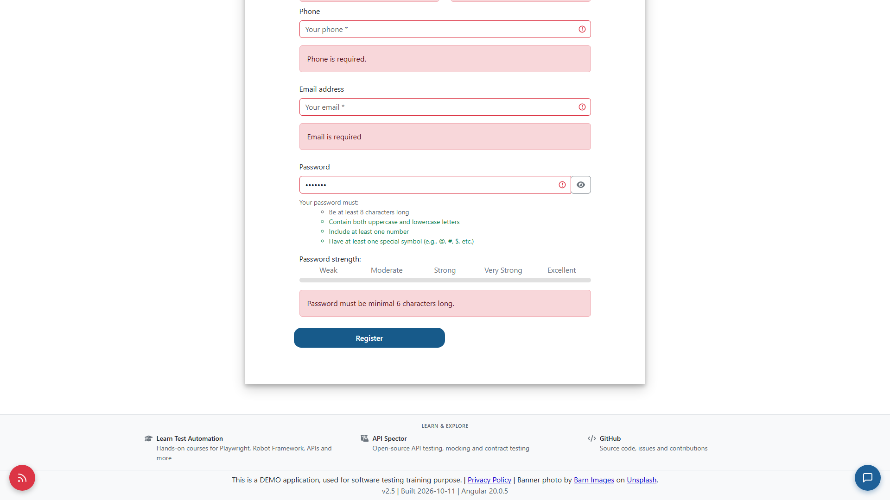
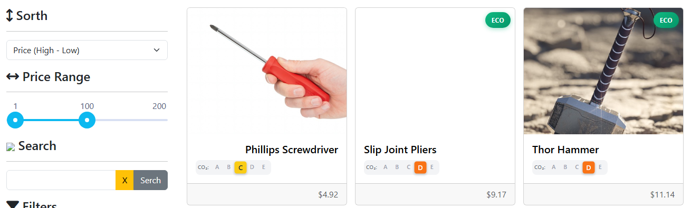
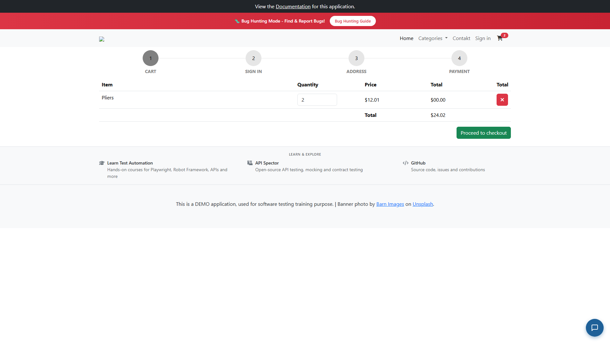

# Bug Reports - Toolshop

Severity and priority follow the definitions in TEST_PLAN.md (section 8).

| ID | Title | Environment | Severity | Priority | Linked |
|---|---|---|---|---|---|
| BUG-01 | Cart quantity limit of 99 can be bypassed by adding the same product twice | Stable | High | P2 - Medium | CHK-11, TC-01 |
| BUG-02 | Registration password error says "minimal 6 characters" while the real rule is 8 | Stable | Low | P3 - Low | CHK-06, TC-03 |
| BUG-03 | All sort options send the opposite sort direction ("Price (High - Low)" shows cheapest first) | Buggy | Medium | P3 - Low | CHK-22, CHK-23 |
| BUG-04 | Cart line total shows "$00.00" for every product, cart total is correct | Buggy | Medium | P2 - Medium | CHK-10 |

BUG-01 and BUG-02 were found on the stable site during the Day 2 checklist run and re-checked on 2026-10-20.
BUG-03 and BUG-04 were found during an exploratory session on the buggy site on 2026-10-20 (charter: "explore catalog sorting and cart calculation with DevTools open").

---

## BUG-01 - Cart quantity limit of 99 can be bypassed by adding the same product twice

| Field | Value |
|---|---|
| Environment | Stable, https://practicesoftwaretesting.com (footer: v2.5, built 2026-10-11), API https://api.practicesoftwaretesting.com, as of 2026-10-20 |
| Browser | Chrome (latest) 1920x1080, re-checked in Playwright Chromium (headless) |
| Severity | High - cart calculation works wrong, the cart line and total go above the allowed limit |
| Priority | P2 - Medium - a business rule is broken in a High risk area (cart), but normal orders are not blocked |
| Linked | CHK-11, TC-01 |
| Reproducibility | 2 of 2 attempts |

**Preconditions:** User is not logged in (guest), cart is empty. The quantity field on the product page allows 1-99 (`min="1"`, `max="99"`, typing `100` shows "You can order at most 99 of this product.").

**Steps to reproduce:**

1. Open https://practicesoftwaretesting.com and search for `Claw Hammer`.
2. Open the "Claw Hammer" product page ($11.48).
3. Type `99` in the quantity field and click "Add to cart".
4. Type `99` in the quantity field again and click "Add to cart".
5. Open the cart.

**Expected result:** The cart line for Claw Hammer never goes above 99. On the second add the user sees "You can order at most 99 of this product." (or the quantity stays at 99), cart total is at most $1,136.52 (99 x $11.48).

**Actual result:** Both adds succeed with the toast "Product added to shopping cart.". The cart counter in the header shows 198, the cart line has quantity 198 and the total is $2,273.04 (198 x $11.48). "Proceed to checkout" is available.

**DevTools / technical observation:**

- Network: each add sends `POST /carts/{cart_id}` with body `{"product_id":"...","quantity":99}`. Both requests return `200 {"result":"item added or updated"}`, then `GET /carts/{cart_id}` returns the item with `"quantity":198`.
- The API does validate the quantity of a single request: `POST /carts/{cart_id}` with `"quantity":150` returns `422 {"message":"The quantity field must not be greater than 99."}`.
- Root cause (likely): the 99 limit is checked only for the requested quantity, not for the resulting cart line (existing quantity + new quantity). Both the UI and the API add the quantities without checking the sum.
- Console: no errors related to the add. The `401` on `GET /users/me` is expected for a guest user and is not related.
- Checkout does not stop the wrong quantity: after login (demo customer) the cart still has 198 items, the Billing address step accepts the address (Hlavna 12, Bratislava, Bratislavsky kraj, Slovakia, 81101), and on the Payment step "Bank Transfer" + "Check payment" sends `POST /payment/check` -> `200 {"message":"Payment was successful"}`, the "Confirm" button is shown. The request body has only the payment method and bank details, no cart quantity or amount, so this step does not validate the cart either.
- "Confirm" was not clicked, to avoid creating an order with wrong data on the shared demo. So it is not checked whether the API rejects the order at the last step.

**Screenshot:**

---

## BUG-02 - Registration password error says "minimal 6 characters" while the real rule is 8

| Field | Value |
|---|---|
| Environment | Stable, https://practicesoftwaretesting.com (footer: v2.5, built 2026-10-11), API https://api.practicesoftwaretesting.com, as of 2026-10-20 |
| Browser | Chrome (latest) 1920x1080, re-checked in Playwright Chromium (headless) |
| Severity | Low - text issue, validation itself works correctly |
| Priority | P3 - Low - misleading for new customers, but registration is possible |
| Linked | CHK-06, TC-03 |
| Reproducibility | Always |

**Preconditions:** User is logged out. Registration page is open: https://practicesoftwaretesting.com/auth/register

**Steps to reproduce:**

1. Type `Ab1!xyz` (7 characters, has uppercase, lowercase, number and symbol) in the Password field.
2. Leave the other fields empty and click "Register".
3. Check the message under the Password field and the hint "Your password must:".

**Expected result:** The error text matches the hint and the real rule, for example "Password must be at least 8 characters long."

**Actual result:** The hint says "Be at least 8 characters long", and 7 characters are rejected, but the error message says "Password must be minimal 6 characters long.". A user who follows the error message and enters 6 or 7 characters is rejected again. 8 characters (`Ab1!xyz7`) are accepted, so the real minimum is 8.

**DevTools / technical observation:**

- Network: the server rule is 8. `POST /users/register` with a valid body and password `Ab1!xyz` returns `422 {"password":["The password field must be at least 8 characters."]}`.
- The wrong text comes from the frontend translation file `GET /assets/i18n/en.json`, key `fields.password.errors.minlength`: `"Password must be minimal 6 characters long."`.
- Root cause: the error text in the translation file was not updated when the minimum length was changed to 8. The validator, the hint and the API all use 8.
- Console: no errors related to the form. The `401` on `GET /users/me` is expected for a guest user.

**Screenshot:**

---

## BUG-03 - All sort options send the opposite sort direction ("Price (High - Low)" shows cheapest first)

| Field | Value |
|---|---|
| Environment | Buggy, https://with-bugs.practicesoftwaretesting.com, API https://api-with-bugs.practicesoftwaretesting.com, as of 2026-10-20 |
| Browser | Playwright Chromium (headless) 1920x1080 |
| Severity | Medium - sorting works wrong, but the user has a workaround (choose the opposite option) |
| Priority | P3 - Low - sorting is a Low risk area in the risk matrix (TEST_PLAN.md, section 10), it does not block a purchase |
| Linked | CHK-22, CHK-23 (same checks pass on the stable site) |
| Reproducibility | Always, 4 of 4 sort options |

**Preconditions:** Home page is open, no search or filters (default price range 1-100).

**Steps to reproduce:**

1. Open https://with-bugs.practicesoftwaretesting.com
2. In the "Sorth" dropdown select "Price (High - Low)".
3. Check the prices of the first products in the grid.
4. Repeat for "Price (Low - High)", "Name (A - Z)" and "Name (Z - A)".

**Expected result:** Each option sorts in the direction of its label. "Price (High - Low)" shows the most expensive product within the slider range (1-100) first.

**Actual result:** "Price (High - Low)" shows the cheapest products first: $4.92, $9.17, $11.14, $11.48, $12.01 ... All 4 options are reversed.
All rows below were checked in the UI under the same condition: home page, no search, default slider 1-100.

| Selected option | Request sent by the UI | Grid shows |
|---|---|---|
| Price (High - Low) | `GET /products?sort=price,asc&between=price,1&page=0` | Cheapest first ($4.92, $9.17, $11.14 ...) |
| Price (Low - High) | `GET /products?sort=price,desc&between=price,1&page=0` | Most expensive first ($125.23, $119.24, $100.79 ...) |
| Name (A - Z) | `GET /products?sort=name,desc&between=price,1&page=0` | "Wood Saw" first |
| Name (Z - A) | `GET /products?sort=name,asc&between=price,1&page=0` | "Adjustable Wrench" first |

**Why the highest price is $125.23 here and $89.55 in CHK-22:** the two sites have different catalogs, and the buggy UI also drops the upper slider bound. Comparison of the "most expensive first" result:

| Condition | Price filter actually applied | Products | Highest price |
|---|---|---|---|
| Stable UI, slider 1-100 (CHK-22) | `QUERY /products`, body `"between":"price,1,100"` | 45 of 50 | $89.55 |
| Buggy UI, slider 1-100 | `between=price,1` (upper bound missing) | 26 of 26 | $125.23 |
| Buggy API, direct call `between=price,1,100` | 1-100 | 23 of 26 | $80.19 |
| Buggy API, direct call without `between` | none | 26 of 26 | $125.23 |

So on the buggy site the slider shows 1-100, but the 3 products above $100 (Cordless Drill 20V $125.23, Cordless Drill 18V $119.24, Random Orbit Sander $100.79) are still listed. This is a separate defect from the reversed sort, see "Other observations".

**DevTools / technical observation:**

- Network: selecting "Price (High - Low)" sends `GET /products?sort=price,asc&between=price,1&page=0`, response `200`. The API returns exactly what was asked (ascending), and the grid renders the response correctly.
- Elements: the dropdown options have swapped values, for example `<option value="price,asc">Price (High - Low)</option>` and `<option value="name,desc">Name (A - Z)</option>`. On the stable site the same option is `<option value="price,desc">Price (High - Low)</option>`.
- Root cause: the option values in the frontend sort dropdown are mapped to the wrong labels. The API is not the problem: calling it directly with `sort=price,desc` returns the most expensive products first.
- Note: the stable site sends the product list request as `QUERY /products` with the filters in a JSON body, the buggy site sends `GET /products?...` with the filters in the URL.
- Console: no errors related to sorting.

**Screenshot:**

---

## BUG-04 - Cart line total shows "$00.00" for every product, cart total is correct

| Field | Value |
|---|---|
| Environment | Buggy, https://with-bugs.practicesoftwaretesting.com, as of 2026-10-20 |
| Browser | Playwright Chromium (headless) 1920x1080 |
| Severity | Medium - the customer cannot check the price per line, but the cart total is correct and can be used instead |
| Priority | P2 - Medium - cart calculation is a High risk area, a "$00.00" next to each product makes customers doubt the total |
| Linked | CHK-10 (passes on the stable site) |
| Reproducibility | Always (1 product and 2 products, quantity 1, 2 and 3) |

**Preconditions:** Cart is empty, user is not logged in (guest).

**Steps to reproduce:**

1. Open https://with-bugs.practicesoftwaretesting.com and open the "Pliers" product page ($12.01).
2. Set quantity to `2` and click "Add to cart".
3. Open the cart.
4. Check the "Total" column of the Pliers line and the cart total.

**Expected result:** Pliers line total is $24.02 (2 x $12.01), cart total is $24.02.

**Actual result:** The line total is "$00.00", the cart total is $24.02. The same happens for every line: Pliers x3 + Claw Hammer x1 show "$00.00" and "$00.00" with a correct cart total of $47.51.

**DevTools / technical observation:**

- Network: the buggy site does not call `/carts` on the API at all (on the stable site every add sends `POST /carts/{id}`). The cart is kept in the browser.
- Application -> Session Storage: key `cart` = `[{"id":2,"name":"Pliers","quantity":2,"price":12.01,"total":24.02}]`. So the line total is calculated correctly and stored, it is only not shown.
- Elements: the cell `<td data-test="line-price">$00.00</td>`. The value "$00.00" is not even a normal currency format (that would be `$0.00`), so it looks like a hard-coded placeholder instead of the `total` field.
- Root cause (likely): the cart template does not bind the line total cell to the item `total`, while the cart total uses the correct data.
- Console: no errors related to the cart.

**Screenshot:**

---

## Other observations (buggy site, not reported in detail)

Found in the same session, lower impact, logged here so they are not lost:

- Logo image is broken, `GET /broken.png` returns `404` (Console: "Failed to load resource").
- Typos in the UI: "Sorth", "Serch", "Contakt".
- Cart table has two "Total" column headers, the second one is above the delete button.
- Cart quantity input has `max="10"` (stable site allows up to 99).
- Price slider upper bound is ignored: with the default slider 1-100 the UI sends `between=price,1` instead of `between=price,1,100`, so products above $100 are shown (see BUG-03, comparison table). Candidate for a separate report.
